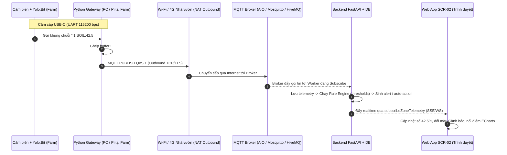

# KIẾN TRÚC HỆ THỐNG & LUỒNG DỮ LIỆU IOT (ARCHITECTURE)

> **Trạng thái hiện tại:** Đã thống nhất khung PoC 1 Zone theo tài liệu và contract hiện hành; các phương án mở rộng Production và đề xuất đổi Broker / giao thức trong Phần II–III là **đề xuất kỹ thuật / Open Questions** chờ chốt cùng nhóm (N, Q) trước khi ghi `docs/decisions/` và cập nhật `contracts/`.
> **Tài liệu liên quan:** `docs/KNOWLEDGE.md`, `docs/REQUIREMENTS.md`, `docs/USE_CASES.md`, `docs/decisions/0001-tech-stack.md`, `docs/decisions/0002-ui-overview-defaults.md`, `contracts/uart.md`, `contracts/mqtt.md`, `contracts/api.md`.

---

## Phần I — Kiến trúc PoC Hiện hành (Đang áp dụng, bám `contracts/`)

### 1.1. Bối cảnh & 5 Module Bắt buộc (CO3111)

Hệ thống đáp ứng đầy đủ 5 module cốt lõi theo `docs/sources/de-bai.pdf`:

1. **Module 1:** Nhận dữ liệu cảm biến đầu vào (`FR-FW-01`, `FR-GW-02`, `FR-FE-01`).
2. **Module 2:** Kiểm tra ngưỡng & phát hiện bất thường (`FR-BE-01`, `FR-BE-02`, `FR-BE-03`).
3. **Module 3:** Điều khiển thiết bị đầu ra tự động & thủ công (`FR-GW-03`, `FR-GW-04`, `FR-BE-04`, `FR-BE-05`, `FR-FE-04`).
4. **Module 4:** Ghi nhận nhật ký hoạt động độc lập (`FR-BE-06`, `FR-BE-07`, `FR-FE-05`).
5. **Module 5:** Data Dashboard trực quan hóa trạng thái, lịch sử và báo cáo động đa chiều HTTT (`FR-BE-08`, `FR-FE-06`, `FR-FE-07`).

### 1.2. Nguyên lý 4 tầng tách biệt (`docs/sources/guides/giao-trinh-iot-python.pdf`)

```mermaid
flowchart LR
  HW["Cảm biến / Relay<br/>(Zone PoC hiện trường)"] <-- "I2C / ADC / GPIO" --> MCU["Vi điều khiển Yolo:Bit<br/>(UART 115200 bps)"]
  MCU <-- "Khung !ZONE:KEY:VAL#" --> GW["Python Gateway<br/>(pyserial + paho-mqtt)"]
  GW <-- "MQTT Outbound<br/>Port 1883 / 8883" --> BRK["MQTT Broker<br/>(AIO PoC hoặc Mosquitto/HiveMQ)"]
  BRK <-- "MQTT Worker<br/>+ Rule Engine" --> BE["FastAPI Backend + DB<br/>(backend/main.py)"]
  BE <-- "HTTPS REST + JWT<br/>& SSE / WebSocket" --> WEB["Responsive Web App<br/>(SCR-01..SCR-10)"]
```

1. **Vi điều khiển (Yolo:Bit + Cảm biến/Relay):** Đọc cảm biến định kỳ, đóng gói bản tin dạng `!1:TEMP:28#` qua **USB Serial (UART 115200 bps)** (`contracts/uart.md`); lắng nghe lệnh `!1:PUMP:ON#` để đóng/ngắt Relay bơm, quạt, đèn (`FR-FW-01`).
2. **IoT Gateway (Python `pyserial` + `paho-mqtt`):** Đọc và cắt khung `! ... #` từ cổng COM, lọc dữ liệu nhiễu rồi Publish lên MQTT Broker (`FR-GW-02`); đồng thời Subscribe topic lệnh để đẩy ngược xuống cổng COM (`FR-GW-03`).
3. **MQTT Broker:** Đóng vai trò trung gian Publish/Subscribe theo Topic; ở cấu hình PoC mặc định bám `contracts/mqtt.md` (`io.adafruit.com`), hoặc chuyển sang Mosquitto/HiveMQ bằng biến môi trường `.env` trong Gateway và Backend.
4. **FastAPI Backend + Web App:** Lưu dữ liệu `telemetry`, chạy Rule Engine kiểm tra ngưỡng, quản lý lịch trình, ghi Audit Log độc lập và đẩy số liệu realtime lên giao diện `SCR-01`..`SCR-10`.

### 1.3. Luồng A · Telemetry Uplink 7 chặng & Điểm tích hợp Simulator

Điểm mấu chốt giúp hệ thống hoạt động qua mạng Wi-Fi / 4G thông thường mà **không cần IP tĩnh hay mở port Router** là cả **Python Gateway** lẫn **FastAPI Backend** đều chủ động mở kết nối **Outbound TCP/TLS** ra MQTT Broker.

1. **Cảm biến → Yolo:Bit:** DHT20 giao tiếp I2C đo nhiệt độ/ẩm không khí; cảm biến ẩm đất và ánh sáng xuất áp analog qua ADC để firmware quy đổi ra `%` và `Lux`.
2. **Yolo:Bit → Python Gateway (`contracts/uart.md`):** Gửi chuỗi `!1:SOIL:42.5#` qua USB Serial `115200 bps` để chống cắt nửa gói.
3. **Xử lý biên tại Python Gateway:** `pyserial` gom đệm theo `! ... #`, loại giá trị lỗi (`FR-GW-02`). Nếu mất mạng, lưu hàng đợi cục bộ kèm timestamp (`NFR-03`); khi có mạng, `paho-mqtt` Publish QoS 1 lên Broker.
4. **Wi-Fi/4G Farm → MQTT Broker:** Router NAT kết nối outbound tới Broker (`8883` TLS hoặc `1883`), Broker kiểm tra credential/ACL và chuyển tiếp bản tin.
5. **MQTT Broker → FastAPI Backend:** Worker nền trong `lifespan` của `backend/main.py` subscribe dữ liệu, cập nhật trạng thái thiết bị `ONLINE`, lưu bảng `telemetry`, đối chiếu `thresholds` (`FR-BE-02`, `FR-BE-05`) để ghi `alerts` hoặc phát lệnh sang Luồng B, rồi đẩy sự kiện qua pub/sub nội bộ.
6. **Backend → Trình duyệt:** `subscribeZoneTelemetry()` trong `frontend/src/lib/api.ts` (hiện dùng adapter SSE prototype) nhận gói mới theo từng `zone_id`.
7. **Hiển thị trên `SCR-02` (< 1–2s):** Cập nhật thẻ số, trạng thái ngữ nghĩa, mô tả đời thường và nối điểm mới trên ECharts.

> **Điểm tích hợp gọn với mã nguồn hiện tại:** `backend/simulator.py` đang mô phỏng đúng Chặng 1–4. Khi đấu nối Yolo:Bit thật cho Zone PoC, toàn bộ Frontend (`SCR-01`..`SCR-10`) và REST API giữ nguyên — chỉ bổ sung thêm 1 MQTT Subscriber Worker (~60 dòng `paho-mqtt`) tại `backend/main.py` cho Zone gắn phần cứng thật.

### 1.4. Luồng B (Command & ACK) & Luồng C (Config & Chịu lỗi Biên)

* **Luồng B · Command & ACK Downlink (`SCR-03` → Relay):** Bấm BẬT/TẮT tại `SCR-03` → Backend kiểm tra RBAC, ghi Audit Log (`FR-BE-06`, `FR-BE-07`) và Publish lệnh kèm `cmd_id`, `max_duration_min` → Gateway/Yolo:Bit đóng Relay, đọc lại trạng thái thật và gửi ACK về Backend (`FR-GW-04`) trước khi cập nhật UI.
* **Luồng C · Config & Chống rớt mạng (`SCR-04`, `NFR-03`):** Ngưỡng và lịch trình sau khi bấm Apply được đẩy xuống Gateway để lưu cục bộ; khi mất Internet, Gateway tự chạy lịch tưới, tự ngắt bơm quá thời gian an toàn (`FR-GW-04`) và đệm tối thiểu `1.000` mẫu cảm biến để đồng bộ bù khi có mạng lại.

---

## Phần II — Cơ sở Kỹ thuật, Định hướng Production & Đối chiếu `dadn.pdf`

> **Phạm vi:** Phần này tổng hợp phân tích kỹ thuật phục vụ viết báo cáo và mở rộng sản phẩm thương mại; chưa bắt buộc cài đặt toàn bộ cơ chế (như SoftAP, Claim Code QR, LoRa, Device Shadow đầy đủ) trong phạm vi đồ án PoC nếu chưa được chốt ở Phần III.

### 2.1. Giới hạn Adafruit IO Free Tier & Lý do Bỏ Node-RED

* **Trần cứng của Adafruit IO Free Tier (theo tài liệu chính thức):**
  1. Tối đa **10 Feeds / tài khoản**: 1 Zone dùng 6 đại lượng/chấp hành (`TEMP`, `HUMI`, `SOIL`, `LIGHT`, `PUMP`, `LED`) đã chiếm 6/10 feeds, không thể mở rộng động `1..N` thiết bị cho nhiều Farm/Zone.
  2. Tối đa **30 điểm dữ liệu / phút** (gộp toàn tài khoản): nhiều cảm biến gửi chu kỳ ngắn sẽ chạm ngưỡng `/throttle` và bị khóa tạm kết nối.
  3. Phải gọi REST API tạo Feed trước khi gửi dữ liệu cho thiết bị mới.
* **Phương án thay thế (Mosquitto / HiveMQ Cloud / EMQX Cloud + FastAPI):**
  * Không giới hạn cấu trúc Topic phân cấp (ví dụ `sf/{tenant}/{device_uid}/telemetry`), không dính trần 30 điểm/phút (HiveMQ Cloud Serverless Free hỗ trợ tới 100 thiết bị, 10GB/tháng).
  * Topic sinh động khi Publish/Subscribe nên không cần gọi API tạo Feed lúc đăng ký thiết bị tại `SCR-10`.
* **Lý do không dùng Node-RED:** FastAPI Backend đã đảm nhiệm REST API, Rule Engine, Scheduler, CSDL và Audit Log độc lập. Đưa Node-RED vào giữa Broker và Backend sẽ tạo thêm tầng trùng lặp logic và gây khó đồng bộ trạng thái.

### 2.2. Quy trình Onboarding Khách hàng Môi trường Production (Tham chiếu)

Để khách hàng ngoài đồng tự lắp thiết bị trong ~3 phút mà **không gõ code hay sửa `.env`**:

1. **Tại xưởng (1 lần):** Nạp sẵn firmware cố định + **`Hardware UID` duy nhất** (ví dụ `SF_GW_1024`) + **`Claim Code` ngẫu nhiên** vào Flash; không nạp sẵn Wi-Fi hay mật khẩu MQTT dùng chung; lưu bản ghi `UNCLAIMED` (`uid`, `claim_code_hash`) ở Backend và dán tem QR lên vỏ hộp.
2. **Tại nông trại (3 bước khách hàng thao tác):**
   * *Bước 1 (Cấp mạng):* Cắm nguồn → bắt Wi-Fi cấu hình tạm (SoftAP/BLE Provisioning) nhập Wi-Fi nhà vườn hoặc dùng SIM 4G công nghiệp.
   * *Bước 2 (Ghép Farm/Zone):* Quét QR / nhập `UID + Claim Code` trên `SCR-10` để gắn thiết bị vào Farm/Zone (`SCR-09`).
   * *Bước 3 (Cấp định danh MQTT riêng):* Backend xác thực Claim Code, cấp MQTT credential / chứng chỉ mTLS riêng kèm luật **Broker ACL** khóa chặt phạm vi topic của thiết bị; thiết bị kết nối **MQTT over TLS (port 8883)** kèm gói **LWT** (`OFFLINE`) và bật cờ `Retain = true` cho bản tin **Device Shadow (`desired` / `reported`)** trên topic config.

### 2.3. Hạ tầng Ngoài trời (Outside Farm), `BROKER_HOST` & Phản biện Cơ chế Claim

* **Kết nối hiện trường Outside Farm:** Wi-Fi 2.4 GHz trên ESP32/Yolo:Bit chỉ phù hợp demo trong phòng hoặc gần nhà điều hành (30–50 m, suy hao mạnh qua mưa/tán cây và tốn pin). Chuẩn Production ngoài trời dùng **LoRa / LoRaWAN** (2–10 km) hoặc **RS-485 có dây chống nhiễu** cho tầng *Cảm biến → Gateway*, và **4G/LTE** cho tầng *Gateway → Internet*.
* **Bắn thẳng Cloud Broker vs. Qua Gateway cục bộ:** PoC 1 kit Yolo:Bit cắm USB vào máy tính chạy Python Gateway gửi thẳng qua Python Gateway lên Cloud Broker (không cần cài thêm Local Mosquitto). Chỉ dựng Local Broker tại Gateway khi có nhiều mạch con dùng Wi-Fi LAN nội bộ hoặc cần chạy tự trị ngoài đồng khi đứt Internet.
* **Phản biện ý tưởng "thiết bị tự bắn `sf/{tenant}/{uid}/telemetry` để Server dò topic rồi popup Claim":** Không nên dùng vì gặp 2 lỗ hổng: (1) thiếu `{tenant}` khi thiết bị chưa từng gắn khách hàng (vấn đề con gà – quả trứng), và (2) nguy cơ giả mạo UID spam popup hoặc Claim nhầm thiết bị giữa các khách hàng (*Device Hijacking*). Trong phạm vi đồ án, phương án gọn và an toàn là **tạo trước `hardware_uid` ở `SCR-10`** để Backend chỉ nhận gói tin khớp danh sách đã đăng ký.
* **`BROKER_HOST` và nơi đặt Broker:** Phải cấu hình bằng **Tên miền (Domain)** (ví dụ `mqtt.smartfarm.vn` hoặc `*.hivemq.cloud`), tuyệt đối không hardcode IP để tránh phải nạp lại firmware khi đổi VPS và để cấp được chứng chỉ TLS 8883. Có thể tự host Mosquitto/EMQX bằng Docker trên VPS riêng (độ trễ gần 0ms, toàn quyền ACL) hoặc dùng HiveMQ/EMQX Cloud Free (tiện khi deploy Backend lên PaaS như Render/Railway).

### 2.4. Đối chiếu & Rút kinh nghiệm từ Báo cáo Mẫu (`docs/sources/past-reports/dadn.pdf`)

| Hạng mục | Thực tế trong `docs/sources/past-reports/dadn.pdf` | Khuyến nghị áp dụng cho Smart Farm |
| :--- | :--- | :--- |
| **Điểm nên học** | Kiến trúc Edge–Fog–Cloud chịu lỗi mất mạng (trang 27–30); tự ngắt bơm theo timeout (mục UC08 trong báo cáo mẫu); Hysteresis chống đóng/ngắt Relay liên tục; gửi Config `Retain=true`, hiển thị `Pending Sync` và đợi **ACK thật** mới cập nhật UI. | Áp dụng Hysteresis, timeout chống tràn, ACK thật và Retained Config vào thiết kế Gateway và phần giải pháp kỹ thuật trong báo cáo. |
| **Điểm không sao chép** | Stack quá nặng (Local Broker + Node-RED + Cloud Broker + Spring WebFlux + Redis Cluster + MongoDB Replica Set + AI — nhiều mục như 3.5, 3.6, 4.3 còn bỏ trống); mô hình `Greenhouse → Zone → Row` dư tầng với ngoài trời; thiếu RBAC Admin/Operator, Audit Log toàn hệ thống và Báo cáo động HTTT. | Giữ gọn theo hướng Ponytail Ultra: **Python Gateway → 1 MQTT Broker → FastAPI + SQLite/PostgreSQL → React**, giữ cấu trúc `Farm → Zone → Device` và bám trọng tâm HTTT. |
| **Điểm cải tiến** | Mã hóa cứng `z_{zone_id}/r_{row_id}` vào MQTT Topic nên khi chuyển vị trí thiết bị phải cấu hình lại mạch. | Topic gắn theo **`device_uid`** (`sf/{tenant}/{device_uid}/telemetry`), ánh xạ thiết bị vào Zone bằng CSDL Backend để đổi Zone 1 chạm tại `SCR-10`. |

---

## Phần III — Open Questions Cần Chốt Cùng Nhóm (N, Q) & Bàn giao Session Mới

### 3.1. Open Questions (chốt xong mới ghi `docs/decisions/` và sửa `contracts/`)

- [ ] **OQ-Broker:** Chốt dùng **Adafruit IO** cho demo PoC 1 Zone (`contracts/mqtt.md`, chu kỳ gửi ≥ 15–30s để không vượt 30 điểm/phút) hay chuyển hẳn sang **Mosquitto (Docker) / HiveMQ Cloud Free**?
- [ ] **OQ-Link:** Ở Zone PoC với 1 bộ kit Yolo:Bit, nhóm phần cứng (N, Q) kết nối **USB-UART** (`contracts/uart.md`) vào Python Gateway hay dùng **Wi-Fi trực tiếp trên ESP32** của Yolo:Bit?
- [ ] **OQ-Provisioning:** Trong phạm vi đồ án, giữ cơ chế **khai báo trước `hardware_uid` ở `SCR-10`** để Backend khớp dữ liệu hay bổ sung thêm luồng **Claim Code**?
- [ ] **OQ-Realtime:** Giữ **SSE** (đã chạy trong `backend/main.py` và `subscribeZoneTelemetry()` của `frontend/src/lib/api.ts`) hay chuyển sang **WebSocket** khi viết ADR chính thức?

### 3.2. Checklist Bàn giao Session Triển khai Phần cứng & Gateway

1. **Đọc trước khi code:** `docs/ARCHITECTURE.md` (file này), `docs/REQUIREMENTS.md` (`FR-FW-01`, `FR-GW-02`, `FR-GW-03`, `FR-GW-04`, `NFR-03`), `contracts/uart.md`, `contracts/mqtt.md`, `backend/main.py`, `backend/simulator.py`.
2. **Chốt Open Questions:** Cập nhật `docs/decisions/` (theo quy tắc đặt tên `NNNN-ten-ngan.md`) và sửa `contracts/mqtt.md` + `contracts/samples/` + test trong cùng commit nếu thay đổi topic hoặc payload.
3. **Thứ tự triển khai code:**
   1. `firmware/`: Đọc DHT20, độ ẩm đất, ánh sáng, LCD 16x2 (`FR-FW-01`), giao tiếp đúng khung `!1:KEY:VALUE#` ở `115200 bps`.
   2. `gateway/`: Python Gateway (`pyserial` + `paho-mqtt`) cấu hình Broker qua `.env`, bộ đệm offline ≥ 1.000 mẫu (`NFR-03`), gửi ACK và tự ngắt bơm theo timeout (`FR-GW-04`).
   3. `backend/`: Bổ sung MQTT Subscriber Worker trong `lifespan` của `backend/main.py` nhận telemetry thật vào DB, chạy Rule Engine và đẩy qua luồng realtime lên `SCR-02`.
4. **Kiểm chứng cuối:** Chạy `powershell -ExecutionPolicy Bypass -File scripts/check.ps1` và test End-to-End từ Yolo:Bit → `SCR-02` và `SCR-03` → Relay thật + Audit Log (`SCR-07`).
