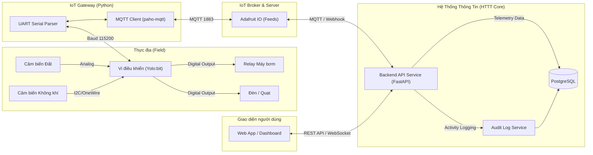

# KIẾN TRÚC HỆ THỐNG SMART FARM (SYSTEM ARCHITECTURE)

**Đồ án:** Smart Farm Device Management System (CO3111 - Chuyên ngành HTTT)  
**Mô hình luồng dữ liệu:** Sensors $\rightarrow$ IoT Gateway $\rightarrow$ Adafruit IO (MQTT) $\rightarrow$ Backend (PostgreSQL) $\rightarrow$ Dashboard / Frontend

---

## 1. BẢN ĐỒ LUỒNG DỮ LIỆU 5 MODULE

---

## 2. QUY CHUẨN 5 MODULE BẮT BUỘC THEO ĐỀ CƯƠNG

* **Module 1 (Input - Thu nhận dữ liệu cảm biến):**
  * Tối thiểu 2 input: Nhiệt độ/Độ ẩm không khí (`DHT20`) và Độ ẩm đất (`Soil Moisture`).
  * Tần suất gửi: 10 giây/lần theo format quy định tại [`contracts/uart.md`](../contracts/uart.md).
* **Module 2 (Threshold - Kiểm tra ngưỡng & Phát hiện bất thường):**
  * Thiết lập min/max cho từng loại cây và mảnh đất (Zone).
  * Kích hoạt cờ cảnh báo (Alert Event) và đẩy thông báo khẩn cấp lên Dashboard.
* **Module 3 (Output - Điều khiển cơ cấu chấp hành):**
  * Tối thiểu 2 output: Máy bơm tưới gốc (Relay) và Đèn cảnh báo / Quạt thông gió.
  * Hỗ trợ 2 chế độ: Điều khiển tự động theo ngưỡng (Auto) và can thiệp thủ công (Manual Override) từ Web/App.
* **Module 4 (Audit Log - Nhật ký hoạt động HTTT):**
  * Ghi nhận độc lập mọi hành động của User (Ai đổi ngưỡng, Ai bật bơm lúc mấy giờ) vào CSDL quan hệ PostgreSQL. Không phụ thuộc log của broker IoT.
* **Module 5 (Dashboard - Trực quan hóa dữ liệu):**
  * Dashboard hiển thị trạng thái thời gian thực và biểu đồ lịch sử đo đạc đa chiều (theo thời gian, theo khu vực, theo trạng thái thiết bị). Hỗ trợ xuất dữ liệu (CSV/Excel/PDF).
